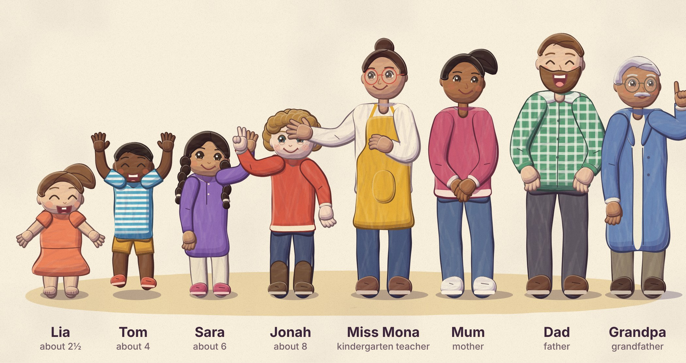
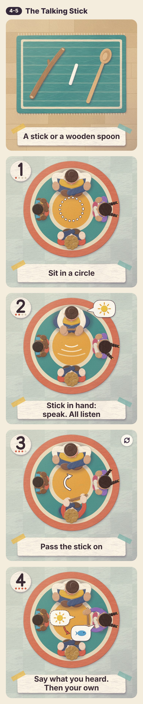
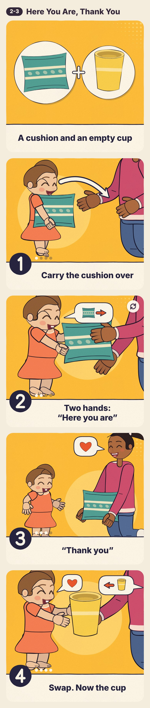
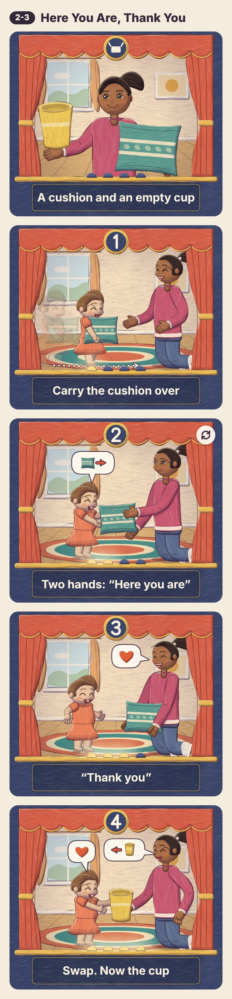

# Activity instruction pictures: three directions to choose from

Every picture and every loop here is drawn in code (no AI image tools, no downloaded art). Each direction shows
the same two activities, so you can compare like with like:

- **"Here You Are, Thank You"** (ages 2-3): a cushion, an empty cup, four steps.
- **"The Talking Stick"** (ages 4-5): a stick or a wooden spoon, four steps.

The captions are real text over the picture, in the user's language (English and Arabic are shown; Hebrew and
Danish are written too). The step that moves in each activity is a short loop, like a GIF.

## The fixed cast

The same eight people will appear under every story: a kindergarten teacher, a mother, a father, a grandfather and
four children of about 2½, 4, 6 and 8. They are not story characters. Each has one colour of their own, so you
know who it is even from a sleeve.

---

## 1 · From above

A photo-like view straight down on the floor: the things and the people are cut paper with soft shadows.
**Good at:** anything about a place, a path or a group (a circle is truly a circle), and the materials picture
looks like a real flat-lay photograph. **Weak at:** you never see a face, so it is the least warm of the three
and the cast is hard to tell apart; small hand actions are harder to read.

Whole set: [phone, activity 1](phone-above-a-en.jpg) · [phone, activity 2](phone-above-b-en.jpg) ·
[Arabic 1](phone-above-a-ar.jpg) · [Arabic 2](phone-above-b-ar.jpg) · [tablet](tablet-above-en.jpg) ·
[contact sheet](contact-above.jpg)

---

## 2 · Hands first

A page from a printed craft book: the camera is so close that the hands and the thing they hold fill the picture,
in one dark line and one strong colour per activity. **Good at:** it reads fastest on a phone, the action cannot
be mistaken, and the child's face is still there, big and happy. **Weak at:** steps about a whole group or a
room (for "sit in a circle" it has to step back), and the grown-up is often only a pair of arms.

Whole set: [phone, activity 1](phone-hands-a-en.jpg) · [phone, activity 2](phone-hands-b-en.jpg) ·
[Arabic 1](phone-hands-a-ar.jpg) · [Arabic 2](phone-hands-b-ar.jpg) · [tablet](tablet-hands-en.jpg) ·
[contact sheet](contact-hands.jpg)

---

## 3 · The little stage

A small paper theatre: the cast act each step as a tiny play, whole people with faces, and one footlight lights
up for every step done. **Good at:** warmth and feeling (you see the mother kneel, the children listen), and it
is the one that feels most like a storybook. **Weak at:** the people are small on a phone and the frame takes
room, so it is the slowest to read; every new activity needs its own little set.

Whole set: [phone, activity 1](phone-stage-a-en.jpg) · [phone, activity 2](phone-stage-b-en.jpg) ·
[Arabic 1](phone-stage-a-ar.jpg) · [Arabic 2](phone-stage-b-ar.jpg) · [tablet](tablet-stage-en.jpg) ·
[contact sheet](contact-stage.jpg)

---

## My recommendation: 2 · Hands first

It is the one a tired parent can read in a second on a phone: big shapes, one action, no scenery to look past.
It still shows the cast's faces, it costs the least to draw for each new activity (no room to build), and it gets
better by itself whenever the figure drawing improves. If you like the warmth of the stage or the flat-lay look
of "from above", they can lend single pictures to it (for example the materials photo, or a circle seen from
above), but I would not mix more than that.

## What is still weak (honest list)

- Hands are the builder's standard hands, enlarged: clear, but not yet beautiful when they fill the picture.
- Arabic and Hebrew captions are set in the test machine's plain font; the site's real fonts will replace it.
  The Arabic, Hebrew and Danish wording is sample text and needs a native reader.
- "From above" uses its own small top-view figure, separate from the main figure builder, so it would need its
  own upkeep.
- In the loops for "pass the stick" (directions 2 and 3) the picture fades back to its start; it does not travel on
  round the circle.
- The brief named the first activity as story A04's; in the outlines today it belongs to A03 ("Thank You, Mama").
  The activity itself is drawn exactly as written there.

## Where everything is

- This folder: phone-size sheets (`phone-…jpg`), tablet sheets, one contact sheet per direction, one loop per
  direction, and a folder per direction with every still and loop (English and Arabic; MP4 and animated WebP).
- Live, with all four languages and the loops playing: the lab page `/lab/instructions` (dev server).
- Code: `src/studio/instructions/` (one file per direction), `src/studio/style/instruction-profiles.ts`,
  `src/cast/instruction-cast.ts`. Re-render everything: `node studio/scripts/instructions-export.mjs all`.
